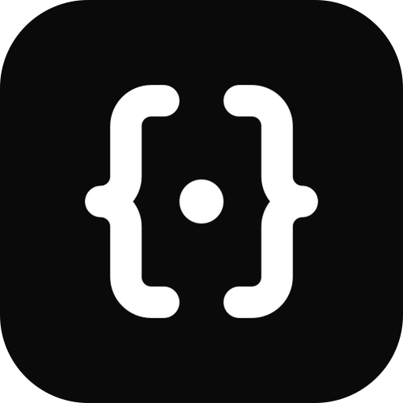

<p align="center">
  
</p>

<h1 align="center">APIMock MCP Server</h1>

<p align="center">
  <b>Free hosted mock APIs that you or your AI agent can build and debug.</b>
</p>

<p align="center">
  <a href="https://apimock.dev"></a>
  <a href="https://apimock.dev/docs/mcp"></a>
  <a href="https://registry.modelcontextprotocol.io"></a>
  <a href="LICENSE"></a>
</p>

---

[APIMock](https://apimock.dev) provides hosted mock REST APIs with custom subdomains (`{slug}.apimock.dev`), stateful CRUD collections, response variants, OpenAPI import, and fault simulation.

This repository holds the **Model Context Protocol (MCP)** manifest and client guides for connecting **Claude, Cursor, Cline, Windsurf, and other AI coding agents** directly to APIMock.

- **Remote MCP Endpoint:** `https://app.apimock.dev/api/mcp` (Streamable HTTP)
- **Authentication:** OAuth 2.0 (native in Claude.ai) or Bearer Personal Access Token (`am_pat_...`)
- **Official Registry Identifier:** `dev.apimock/apimock`

---

## Quick Client Configurations

### 1. Claude.ai (Custom Connector)

Claude.ai natively connects to APIMock using OAuth 2.0:

1. Open **Claude.ai → Settings → Connected apps**.
2. Click **Add custom connector**.
3. Name: `APIMock`
4. Server URL: `https://app.apimock.dev/api/mcp`
5. Click **Connect** and authorize your APIMock workspace.

---

### 2. Cursor IDE

Add APIMock to your Cursor Settings (**Features → MCP**) or create `.cursor/mcp.json` in your project:

```json
{
  "mcpServers": {
    "apimock": {
      "url": "https://app.apimock.dev/api/mcp",
      "headers": {
        "Authorization": "Bearer am_pat_YOUR_TOKEN"
      }
    }
  }
}
```

> **Tip:** Generate a Personal Access Token (`am_pat_...`) under **[Settings → API Tokens](https://app.apimock.dev/settings/tokens)** on APIMock.

---

### 3. Claude Desktop

Add APIMock to your `claude_desktop_config.json`:

* **macOS:** `~/Library/Application Support/Claude/claude_desktop_config.json`
* **Windows:** `%APPDATA%\Claude\claude_desktop_config.json`

```json
{
  "mcpServers": {
    "apimock": {
      "url": "https://app.apimock.dev/api/mcp",
      "headers": {
        "Authorization": "Bearer am_pat_YOUR_TOKEN"
      }
    }
  }
}
```

---

### 4. Cline / Roo Code (VS Code Extension)

1. Open Cline or Roo Code settings in VS Code.
2. Under **MCP Servers**, add a new server:
   * **Name:** `apimock`
   * **Type:** `streamable-http` (or `sse`)
   * **URL:** `https://app.apimock.dev/api/mcp`
   * **Headers:** `Authorization: Bearer am_pat_YOUR_TOKEN`

---

### 5. Windsurf (Codeium)

Add to `~/.codeium/windsurf/mcp_config.json`:

```json
{
  "mcpServers": {
    "apimock": {
      "serverUrl": "https://app.apimock.dev/api/mcp",
      "headers": {
        "Authorization": "Bearer am_pat_YOUR_TOKEN"
      }
    }
  }
}
```

---

## Available MCP Tools

APIMock exposes **20 tools** across building, debugging, and testing mock backends:

### Building & Mock Generation
| Tool | Description |
| :--- | :--- |
| `scaffold_backend` | Generate an entire backend with multiple persistent CRUD resources, relationships, and seed data in one prompt. |
| `create_resource` | Declare a persistent CRUD collection (generates `list`, `get`, `create`, `update`, `delete` endpoints). |
| `create_endpoint` | Create a standalone mock route with static or templated JSON response. |
| `import_openapi` | Import an OpenAPI / Swagger document to generate mocks and schemas in place. |
| `list_endpoints` / `get_endpoint` | Inspect configured endpoints within a workspace. |
| `update_endpoint` / `delete_endpoint` | Modify responses, headers, status codes, or delete endpoints. |
| `list_workspaces` | List all workspaces accessible by the authenticated token or OAuth user. |
| `list_folders` / `create_folder` | Organize endpoints into logical folders. |

### Debugging & Self-Healing
| Tool | Description |
| :--- | :--- |
| `inspect_failed_requests` | Inspect recent 404s or failed calls sent to your mock subdomain. |
| `heal_mock_endpoint` | Automatically patch or create a mock endpoint to match what your client actually sent. |
| `simulate_request` | Test how APIMock would route and respond to an incoming request without sending external network traffic. |

### Fault Injection & Chaos Testing
| Tool | Description |
| :--- | :--- |
| `set_fault_rule` | Inject latency, 5xx server errors, or corrupted payloads by route pattern or probability. |
| `list_fault_rules` | View active fault rules on a workspace. |
| `clear_fault_rules` | Remove all active faults when testing completes. |

---

## MCP Resources

The server exposes read-only live contracts for your agent:

- `workspace://{slug}/openapi.json` — The OpenAPI 3.1 specification generated for your workspace.
- `workspace://{slug}/types.d.ts` — TypeScript type definitions generated from your resources and endpoints.

---

## Limits & Free Tier

- **50,000 mock requests/month** per workspace.
- **Up to 3 workspaces** per user account with team sharing.
- **100% Free** — no credit card required.

---

## Links & Community

- **Website:** [https://apimock.dev](https://apimock.dev)
- **MCP Documentation:** [https://apimock.dev/docs/mcp](https://apimock.dev/docs/mcp)
- **Quickstart Guide:** [https://apimock.dev/docs/quickstart](https://apimock.dev/docs/quickstart)
- **Privacy Policy:** [https://apimock.dev/privacy](https://apimock.dev/privacy)
- **Terms of Service:** [https://apimock.dev/terms](https://apimock.dev/terms)

---

## License

[MIT](LICENSE)
